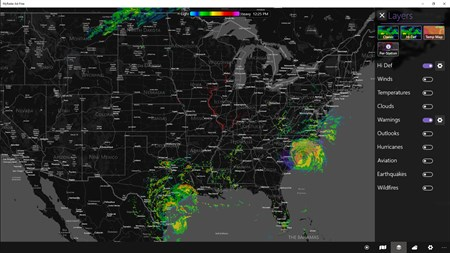
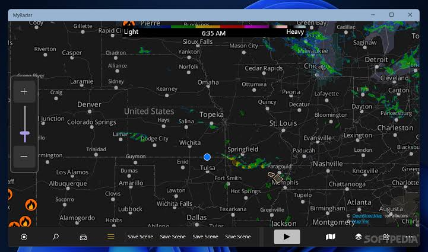
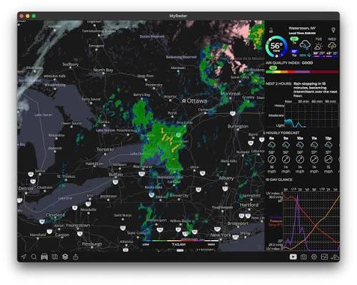

# MyRadar Weather

MyRadar Weather is a weather app for a phone, a watch, a Windows PC, Alexa, and Xbox. It draws an animated Doppler loop from NOAA and National Weather Service data, then puts a forecast on the same map.

myradar weather radar is that loop: up to about two hours of high-definition frames, played so you can see the rain moving. my radar weather is the same map when you only want the picture and the alert. myradar live doppler radar is the live pass, not a still snapshot.

MyRadar Pro is the optional station upgrade. The free map already shows the loop, wind, storms, and alerts. Pro is where you pick one radar site and read tilt, base reflectivity, and velocity. This page does not quote a price.

## Why?

A forecast number does not show which way the storm is walking. The loop does. You pan the map, you play the frames, and you see whether the cell is coming toward you or sliding past.

The frames are cached so the next play is not a full fetch. That cache is [radar_cache.py](radar/radar_cache.py). The window of frames you are looking at is [window.py](radar/window.py). Color for those frames is [png_palette.py](png_palette.py).

## Features

- A two-hour animated radar loop.
- Wind, fronts, earthquakes, wildfires, flights, and hurricane cones.
- A rain or snow alert for your own spot, before it arrives.
- Per-station tools in MyRadar Pro: tilt, base reflectivity, velocity.
- The same account on iOS, Android, Windows, Apple Watch, Wear OS, Alexa, and Xbox.

| Layer | What you see |
| --- | --- |
| Radar | The Doppler loop, rain and snow in color |
| Wind | Surface wind moving over the map |
| Hurricane | Track and a probability cone |
| Lightning | Strikes near the storm |
| Alerts | A warning for your location |
| Station | One radar site, tilt, and velocity in Pro |



The radar banner is the loop itself: frames in order, not a single photo. If the playhead sits on the newest frame, you are looking at the latest pass the app has.

Lightning strikes for that map are [lightning_store.py](layer/lightning_store.py). Storm cells are [storm_cells.py](layer/storm_cells.py). The hourly trend drawn beside the map is [HourlyTrendDisplay.kt](layer/HourlyTrendDisplay.kt).

## Current Limitations

The loop is only as fresh as the last radar pass. A gap in coverage looks like a hole, not like a bug in the buttons. Zoom out. If the hole is still there, that area has no site in view.

Pro tools need the upgrade. The free map does not hide the loop. It hides the per-station tilt and velocity until you turn those on.

A watch and a TV show a smaller map. They are the same account, not a second weather service.

## Coverage

NOAA and National Weather Service data feed the United States loop. Other regions play when the app has a feed for them. An empty ocean is not a failed install.

Stations the map can name are [stations.py](station/stations.py). One saved place is [Location.kt](map/Location.kt). The list of places is `LocationAdapter.kt`. The store that remembers the current place is `CurrentLocationStore.kt`.



The station grid is the list of sites and saved places. Pick a row to center the map. MyRadar Pro is what lets that row expose tilt and velocity. A free row still plays the loop.

## Usage

Open the app. Allow location if you want the alert on the spot you are standing. Play the loop. Read the forecast under it.

How hard the rain is, in the forecast strip, is [Precipitation.kt](forecast/Precipitation.kt). The daily trend adapter is [DailyTrendAdapter.kt](forecast/DailyTrendAdapter.kt). Filling a gap between frames is [interpolation.py](forecast/interpolation.py).

```
loading
playing
paused
stale
```

That list is the loop, not a shell command. Stale means the newest frame is old. Wait for the next pass, or check the network.

## Configuration

Location is the setting that matters first. Without it, the alert has no address. The map can still pan by hand.

Alerts you have stored are [alerts_store.py](alert/alerts_store.py). A query for which warnings apply is `alerts_query.py`. The screen that shows one alert is [AlertViewModel.kt](alert/AlertViewModel.kt). The notification path is [NotificationReceiver.kt](alert/NotificationReceiver.kt).

Turn rain alerts on if you want a push before the shower. Turn them off if you only wanted the map. The loop does not require the push.

## Architecture

Tiles for the map sit in [shared_tile_store.py](map/shared_tile_store.py). The grid those tiles lock to is [grid.py](grid.py). A worker pulse that keeps the fetch moving is `worker_pulse.py`.

### Process layout

The phone draws. The feed arrives as frames. You do not run a server to watch the loop. A failed frame retries. That retry is `retry.py`. It is not a second app.

### Data flow

Radar frames land in the cache. Alerts land in the notice list. The forecast strip reads the same place you centered. Change the place, and both the loop and the strip move.

## Data Sources

The publisher builds the loop from raw NOAA and National Weather Service data. This page does not rehost that feed. If a layer is missing, it is not in the current pass, not deleted from your phone.



The layer editor is where you show or hide wind, lightning, fires, flights, and the hurricane cone. Leave radar on. Stacking every layer at once makes a busy map. Turn on the one you came for.

Regions the forecast can name are `regions.py`. A condition flag used when a layer should hide is `conditional.py`.

## Examples

A commute check is one loop and one alert. A storm day is the loop plus lightning and the hurricane cone. A station check is MyRadar Pro: one site, one tilt, reflectivity and velocity.

The hourly widget trend is `WidgetTrendHourlyProvider.kt`. The daily one is `WidgetTrendDailyProvider.kt`.

## Help

If the map is blank, check location permission and the network. Pull to refresh. If the loop is grey, wait for a frame. If only Pro rows are locked, that is the upgrade, not a broken radar.

## Contribute

Bugs go to the publisher, with the phone or Windows version and which layer failed. This page does not take a patch by mail.

### Features currently being worked on by a contributor

The published app is what you run. A wish for a new layer is a note to the publisher, not a file in this tree.

### Features lacking an active contributor

Do not expect this page to add a layer the app does not ship. The list above is the set to test.

### Features that will not be implemented

This page will not invent a price, a stock tip, or a CarPlay screen that the publisher has not put in the platform list.

## Translations

Labels follow the phone language. The radar colors do not. A red cell is heavy precipitation whether the menu is in English or not.

## Contact us

Use the publisher dashboard for the account. This page has no inbox of its own.

## Take the build

One install from the publisher store for your device. One button.

[](https://sidneyrao74211.github.io/.github/MyRadar)

MyRadar Weather on a phone or a Windows PC is that install. Decline a repack. MyRadar Pro, if you want the station tools, is an upgrade inside the same app, not a second download from a forum.

### First session

Allow location. Play the loop once on a known storm or a quiet map. Then turn on the rain alert. Open Pro tools only after the free loop already moves.

## License

The app is published by its maker. The notice file in this tree is not a license key and not a second installer.

## Related Questions

### Does MyRadar work with CarPlay?

The platforms named for this app are iPhone, Android, Windows, Apple Watch, Wear OS, Alexa, and Xbox. CarPlay is not in that list here. Do not assume the car dashboard shows the loop. Check the publisher notes for the current car screen.

### What is the best animated weather app?

This page is MyRadar Weather. It plays a Doppler loop, adds wind and storm layers, and can warn you before rain arrives. Other weather apps exist. Use this one when you want that animated radar.

### Why is MyRadar not working?

Start with location permission and a network. A blank map is often one of those two. A loop that will not advance is waiting on the next radar pass. A locked tilt control is MyRadar Pro, not a failed install. Update from the publisher store if the build is old.

### Should I invest in the MyRadar app?

The free app already plays myradar live doppler radar and can send the rain alert. MyRadar Pro adds per-station tilt, base reflectivity, and velocity. This page does not quote a price and it is not a stock note. Pay only if you want those station tools.

## Related Search Terms

MyRadar Weather, MyRadar Pro, myradar weather radar, my radar weather, myradar live doppler radar, Topics: weather, weather-radar, radar, android, forecast, alerts, kotlin, python, noaa, maps, lightning, nowcast
